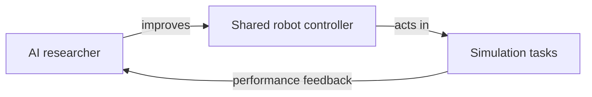

# Worldsmith

Worldsmith is an ongoing research project asking whether an autonomous AI researcher can improve general-purpose robot control through iterative simulation experiments.
The goal is to develop reusable skills and representations that transfer across tasks and embodiments, reducing the need to engineer a separate solution for each problem.
Generalization remains an open research question.

## Research approach

An autonomous AI researcher develops and improves a shared robot controller, tests it across simulation tasks, and uses performance feedback to guide the next experiment.
The researcher works between experiments; the runtime controller observes and acts within each episode.
Development feedback is kept separate from owner validation to help assess transfer beyond the tasks and initial conditions used during experimentation.

## Research loop



## Benchmarks

Worldsmith spans **20 tasks across four simulation environments**, covering planar movement, manipulation, locomotion, and coordinated control.

| Environment | Tasks | Control problems |
| --- | ---: | --- |
| Pymunk | 5 | Interception, navigation, tracking, and pushing |
| ManiSkill | 8 | Manipulation, precision insertion, and quadruped locomotion |
| LIBERO-PRO | 3 | Drawer opening and object placement |
| RoboSuite | 4 | Doors, assembly, two-arm handover, and wiping |

Current tasks use structured state observations rather than camera images.
See the [benchmark inventory](BENCHMARKS.md) for task details and development/validation partitions.

## Getting started

From the repository root, install the pinned Pymunk environment with [uv](https://docs.astral.sh/uv/) and run the fast tests:

```sh
uv sync --locked
uv run --locked python -m pytest
```

The other simulators use separate environments with their own setup instructions and opt-in tests:

- [ManiSkill](simulation_environments/maniskill/README.md)
- [LIBERO-PRO](simulation_environments/libero/README.md)
- [RoboSuite](simulation_environments/robosuite/README.md)

## Documentation

- [Research workflow](autoresearch/RESEARCH.md): experiment process and comparison rules.
- [Controller API](autoresearch/API.md): observations, actions, and feedback tools.
- [Development task guide](autoresearch/TASKS.md): task fields, limits, and horizons.
- [Benchmark inventory](BENCHMARKS.md): the full task catalog.
