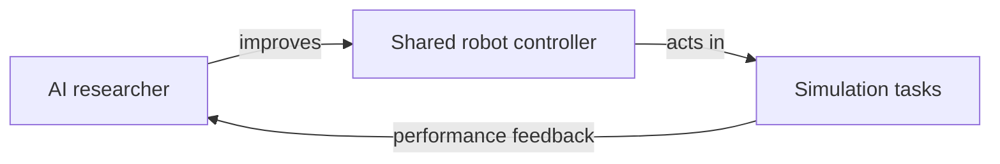

# Worldsmith

Worldsmith is an ongoing research project asking whether an autonomous AI researcher can improve general-purpose robot control through iterative simulation experiments.
The goal is to develop reusable skills and representations that transfer across tasks and embodiments, reducing the need to engineer a separate solution for each problem.
Generalization remains an open research question.

## Research approach

An autonomous AI researcher develops and improves a shared robot controller, tests it across simulation tasks, and uses performance feedback to guide the next experiment.
The researcher works between experiments; the runtime controller observes and acts within each episode.
Development feedback is kept separate from owner validation to help assess transfer beyond the tasks and initial conditions used during experimentation.

## Research loop



## Benchmarks

Worldsmith spans **20 tasks across four simulation environments**, covering planar movement, manipulation, locomotion, and coordinated control.

| Environment | Tasks | Control problems |
| --- | ---: | --- |
| Pymunk | 5 | Interception, navigation, tracking, and pushing |
| ManiSkill | 8 | Manipulation, precision insertion, and quadruped locomotion |
| LIBERO-PRO | 3 | Drawer opening and object placement |
| RoboSuite | 4 | Doors, assembly, two-arm handover, and wiping |

Current tasks use structured state observations rather than camera images.
See the [benchmark inventory](BENCHMARKS.md) for task details and development/validation partitions.

## Getting started

From the repository root, install the pinned Pymunk environment with [uv](https://docs.astral.sh/uv/) and run the fast tests:

```sh
uv sync --locked
uv run --locked python -m pytest
```

The other simulators use separate environments with their own setup instructions and opt-in tests:

- [ManiSkill](simulation_environments/maniskill/README.md)
- [LIBERO-PRO](simulation_environments/libero/README.md)
- [RoboSuite](simulation_environments/robosuite/README.md)

AutoResearch requires an authenticated Google Colab CLI and configured Cloudflare R2 credentials. Run `make colab-build-envs` to prepare the environments, then `make autoresearch` to start a research session.

### SLM inference smoke test (owner workflow)

Reuse a ready Colab session, or start one through the existing workflow:

```sh
make colab-build-envs SIMULATOR=pymunk  # prepare caches if starting a new session
uv run --locked python -m worldsmith.colab start pymunk  # only if no session is tracked
uv run --locked python -m worldsmith.colab slm-smoke
make colab-stop  # release the VM when finished
```

The smoke command installs pinned vLLM and the OpenAI client in `/content/worldsmith/.slm`,
using the owner wheel already transferred at session startup. It loads the pinned
[Qwen3-4B-Instruct-2507](https://huggingface.co/Qwen/Qwen3-4B-Instruct-2507), checks chat,
automatic tool selection with validated distance arguments, and one tool-result reply.
It stops the server on completion or failure; the Colab session stays available.
First use requires network access for dependencies and model weights. Sessions started
before this change need restarting to receive the new wheel and retained package.
Logs are `/content/worldsmith/{slm-install.log,slm-smoke.log,vllm.log}`.

The Apache 2.0, non-thinking 4B model offers a small initial footprint and native tool
templates using vLLM's Hermes parser. Qwen2.5-3B-Instruct is a smaller, older alternative;
Qwen3-8B offers more capacity at higher memory/latency cost. These are practical
tradeoffs, not benchmark results. Model/tokenizer revision and serving settings live in
`worldsmith/inference/config.py`, outside the researcher workspace. This first setup
targets the existing L4 runtime with FP16, an 8K context, and one concurrent sequence;
GPU fit, latency, and tool reliability still require the live smoke test.

For repeated requests, run Python with `/content/worldsmith/.slm/bin/python` in Colab:

```python
from worldsmith.inference.client import create_client
from worldsmith.inference.config import MODEL
from worldsmith.inference.server import ModelServer

with ModelServer(), create_client() as client:
    response = client.chat.completions.create(
        model=MODEL,
        messages=[{"role": "user", "content": "Hello"}],
        temperature=0,
        max_tokens=128,
    )
    print(response.choices[0].message.content)
```

`ModelServer.start()` waits for readiness; `stop()` releases its process group.
Keep one server alive across requests. It binds only `127.0.0.1:8000`; there is no public
tunnel. The client uses `/v1` with a local placeholder API key, a 60-second timeout and
no retries; standard OpenAI connection, timeout and HTTP errors propagate to callers.
PR31 can use the same `MODEL`, `BASE_URL` and `API_KEY` with `ChatOpenAI`.
Run inference between simulator evaluations to avoid GPU memory contention.

## Documentation

- [Research workflow](autoresearch/RESEARCH.md): experiment process and comparison rules.
- [Controller API](autoresearch/API.md): observations, actions, and feedback tools.
- [Development task guide](autoresearch/TASKS.md): task fields, limits, and horizons.
- [Benchmark inventory](BENCHMARKS.md): the full task catalog.
