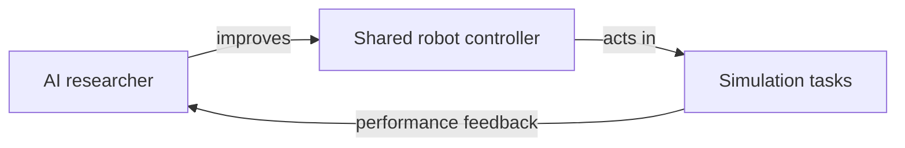

# Worldsmith

Worldsmith is an ongoing research project asking whether an autonomous AI researcher can improve general-purpose robot control through iterative simulation experiments.
The goal is to develop reusable skills and representations that transfer across tasks and embodiments, reducing the need to engineer a separate solution for each problem.
Generalization remains an open research question.

## Research approach

An autonomous AI researcher develops and improves a shared robot controller, tests it across simulation tasks, and uses performance feedback to guide the next experiment.
The researcher works between experiments; the runtime controller observes and acts within each episode.
Development feedback is kept separate from owner validation to help assess transfer beyond the tasks and initial conditions used during experimentation.

## Research loop



## Benchmarks

Worldsmith spans **20 tasks across four simulation environments**, covering planar movement, manipulation, locomotion, and coordinated control.

| Environment | Tasks | Control problems |
| --- | ---: | --- |
| Pymunk | 5 | Interception, navigation, tracking, and pushing |
| ManiSkill | 8 | Manipulation, precision insertion, and quadruped locomotion |
| LIBERO-PRO | 3 | Drawer opening and object placement |
| RoboSuite | 4 | Doors, assembly, two-arm handover, and wiping |

Current tasks use structured state observations rather than camera images.
See the [benchmark inventory](BENCHMARKS.md) for task details and development/validation partitions.

## Getting started

From the repository root, install the pinned Pymunk environment with [uv](https://docs.astral.sh/uv/) and run the fast tests:

```sh
uv sync --locked
uv run --locked python -m pytest
```

The other simulators use separate environments with their own setup instructions and opt-in tests:

- [ManiSkill](simulation_environments/maniskill/README.md)
- [LIBERO-PRO](simulation_environments/libero/README.md)
- [RoboSuite](simulation_environments/robosuite/README.md)

AutoResearch requires an authenticated Google Colab CLI and configured Cloudflare R2 credentials.
Copy `.env.example` to `.env` in the repository root and set your bucket name and
the absolute path to your credentials file. Keep the credentials file outside
the repository, with plain `KEY=value` lines:

```dotenv
R2_ACCOUNT_ID=your-32-character-account-id
R2_ACCESS_KEY_ID=your-access-key
R2_SECRET_ACCESS_KEY=your-secret-key
```

Make targets automatically load `.env` when it exists. Exported environment
variables take precedence over its values. `.env` is ignored by Git; commit only
the placeholder `.env.example`. For direct commands, use
`uv run --env-file .env --locked python ...`.

Run `make colab-build-envs` to prepare the environments, then `make autoresearch`
to start a research session.

### SLM inference

[Qwen3-4B-Instruct-2507](https://huggingface.co/Qwen/Qwen3-4B-Instruct-2507) is served
by vLLM with Hermes tool calling through the OpenAI-compatible API and Python client.
On a Linux NVIDIA GPU host, install the pinned serving dependencies and run the
chat and tool-calling smoke test:

```sh
uv sync --only-group inference
uv pip install --python .venv/bin/python vllm==0.10.2 transformers==4.55.2
.venv/bin/python -m worldsmith.inference.smoke
```

The smoke test starts and stops its own server. Server diagnostics are in `vllm.log`.

With the Colab CLI and R2 credentials configured as above, `make colab-slm-smoke`
prepares, starts, tests, and releases a Colab session. It runs one closed-loop
navigation episode with the frozen model and reports task outcome, environment
steps, and model decisions. The controller uses one native `act` tool, repeats
each action for up to 5 steps, and trims complete conversation interactions using
the pinned tokenizer and the server's 8192-token budget.
`worldsmith.harness.evaluate.evaluate` accepts a positive integer
`action_repeat` to change this fixed frequency. The two generic prompt templates
are in `worldsmith/harness/prompts.py`. The controller also supports the native
vector actions for ManiSkill, LIBERO-PRO, and RoboSuite. It derives dimensions and
bounds from the simulator and describes the existing control semantics in the tool.
With an inference server running, use the selected simulator's Python environment
(with `openai==1.99.9`, `transformers==4.55.2`, and `jinja2==3.1.6` installed) to run
`python -m worldsmith.harness.evaluate --task TASK --output run-directory`.
This uses the shared evaluator to save `summary.json` and `episodes.jsonl`, with
native scores, per-step traces, and the existing controller error handling.

To try a T4 or A100 instead of
the default L4, set `COLAB_GPU=T4` or `COLAB_GPU=A100` on that command. Diagnostic logs are saved to
`runs/colab/<session-name>/{slm-install.log,slm-smoke.log,vllm.log}`.

The smoke workflow stores the pinned model snapshot in R2 under
`worldsmith/cache/models/<model>/<revision>/`. Missing files are downloaded with
Hugging Face's snapshot downloader and saved to R2; later runs restore them from
R2 and set `HF_HUB_CACHE` to that directory with `HF_HUB_OFFLINE=1`. This caches
the model, not Python dependencies or GPU compilation. Progress is in `slm-install.log`.

## Documentation

- [Research workflow](autoresearch/RESEARCH.md): experiment process and comparison rules.
- [Controller API](autoresearch/API.md): observations, actions, and feedback tools.
- [Development task guide](autoresearch/TASKS.md): task fields, limits, and horizons.
- [Benchmark inventory](BENCHMARKS.md): the full task catalog.

## License

Copyright (c) 2026 Noam Carmon. All rights reserved. See LICENSE for details.
