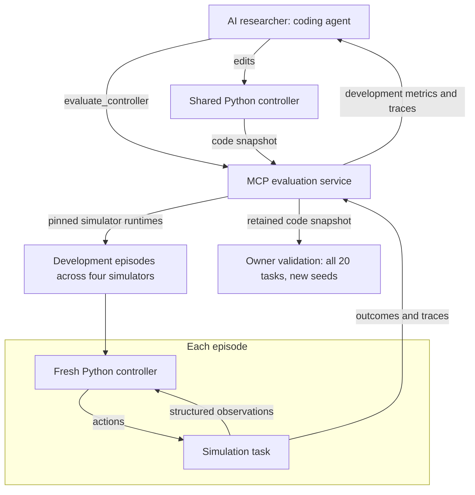

# Worldsmith

Worldsmith is an ongoing research project investigating whether an autonomous AI researcher can improve general-purpose robot control by developing reusable skills and representations through iterative simulation experiments. Generalization matters because robots must adapt to different tasks, physical interactions, and embodiments without requiring a separate controller for every problem.

On `main`, the AI researcher is a coding agent that improves a shared, task-aware Python controller. The runtime controller receives the task and structured observations and produces actions without an LLM. The research goal is to discover control capabilities that transfer across tasks; generalization has not yet been demonstrated.

## Research approach

1. **Develop reusable capabilities.** The researcher inspects failures, forms a hypothesis, and edits the shared controller to improve representations or control strategies.
2. **Execute in simulation.** The evaluation infrastructure snapshots the candidate code and runs a fresh controller for each episode in the task's pinned simulator environment.
3. **Measure and diagnose.** MCP tools return development success rates, task metrics, and observation/action traces.
4. **Iterate on the shared solution.** The researcher keeps candidates that improve the equal-weight mean of task success rates and records findings in a journal. The current session budget is a baseline plus up to three candidate iterations.

The aim is reusable strategies across the suite, rather than independent task-specific controllers. Task awareness is supported by the current API; transfer is a research objective, not an enforced architectural property.

Development uses **16 tasks on seeds 0–7**. Owner validation evaluates the retained code snapshot on **all 20 tasks on seeds 8–15**, including four validation-only tasks. Shared tasks test generalization to new seeds; validation-only tasks test transfer to new tasks. Keeping validation out of the research feedback helps distinguish development-set improvements from broader generalization. Earlier sessions exposed the validation-only tasks; see [validation and replay](#owner-validation-and-replay) for the historical caveat.

## Architecture

The implemented workflow on `main` separates code development from episode control:



Evaluation saves filtered research feedback separately from owner traces and diagnostics. This is a feedback boundary, not OS-level isolation: the researcher and evaluator run under the same account. See the [controller API](autoresearch/API.md) and [research workflow](autoresearch/RESEARCH.md).

## Benchmarks

The benchmark inventory covers **20 tasks across four simulation environments**:

| Environment | Tasks | Control problems |
| --- | ---: | --- |
| Pymunk | 5 | Planar interception, navigation, moving-target tracking, and object pushing with noisy position measurements |
| ManiSkill | 8 | Panda manipulation, shape alignment, ball rolling, precision insertion, and Go2 quadruped locomotion |
| LIBERO-PRO | 3 | Drawer opening and single- or multi-object placement with varied starting layouts |
| RoboSuite | 4 | Latched doors, nut assembly, two-arm hammer handover, and contact-based table wiping |

These tasks span motion prediction, collision avoidance, grasping, constrained contact, precision alignment, locomotion, and coordinated manipulation. Current tasks use **structured state observations, not raw camera images**. Most 3D tasks use fixed-base arms. The [benchmark inventory](BENCHMARKS.md) is the source of truth for task details, embodiments, observations, and validation-only tasks.

## Research progress

- **V1 — initial infrastructure:** Pymunk simulation and autonomous experimentation established the initial workflow. [Historical reproduction instructions](#v1-pymunk-artifacts) remain available.
- **V2 — implemented on `main`:** Expanded coverage to four simulators and 20 tasks, with shared evaluation interfaces, saved controller snapshots and traces, and separate development and owner-validation tasks.
- **V3 — active development:** The planned direction is a fixed small language model as a general-purpose runtime controller, with the researcher developing reusable skills and tools. That runtime architecture is not implemented on `main`; the current controller executes Python without an LLM.

These milestones describe infrastructure and research direction, not evidence that general-purpose control or task generalization has been achieved.

## Getting started

### Setup and local checks

From the repository root, install the pinned Pymunk environment and run the fast tests.

```sh
uv sync --locked
uv run --locked python -m pytest
```

The other simulators use separate environments. Follow their setup guides to install the runtime and run its opt-in tests. [ManiSkill](simulation_environments/maniskill/README.md) · [LIBERO-PRO](simulation_environments/libero/README.md) · [Robosuite](simulation_environments/robosuite/README.md)

For single-task debugging, use the task's pinned interpreter and an explicit seed and episode count.

```sh
uv run --locked python -m worldsmith.benchmark.evaluator \
  --task navigation --episodes 3 --seed 42 --output runs/navigation
```

Supply a different zero-argument controller factory with `--controller module:factory`. Use a new output directory for each run. The evaluator writes `summary.json` and `episodes.jsonl`. Pymunk and ManiSkill default to one worker, and LIBERO-PRO and Robosuite default to two. Use `--workers N` for owner commands or set `WORLDSMITH_EVALUATION_WORKERS` before launching AutoResearch. Parallel workers require an importable factory and write episodes in seed order.

### AutoResearch

With all four environments set up, run `make autoresearch` from the repository root. Use `make autoresearch-maniskill`, `make autoresearch-libero`, or `make autoresearch-robosuite` for one simulator. Pymunk uses the root interpreter. The server defaults to `simulation_environments/<simulator>/.venv/bin/python` for the other simulators. Set `WORLDSMITH_MANISKILL_PYTHON`, `WORLDSMITH_LIBERO_PYTHON`, or `WORLDSMITH_ROBOSUITE_PYTHON` to an absolute path to override it.

The launcher starts from the clean starter, runs the research session, archives it under `research-history/`, and restores the starter after success. If Codex exits with an error, the archive and workspace are both kept. After closing a session and waiting for evaluations to finish, use `make clear-autoresearch` to archive and reset the workspace manually.

#### Manual sessions

Run these commands from the repository root. For a single-task session, the owner sets `WORLDSMITH_RESEARCH_SUITE` to a development task ID before launching Codex, for example `export WORLDSMITH_RESEARCH_SUITE=navigation`. Close the session and wait for evaluations to finish before archiving and resetting.

```sh
uv run --locked python -m worldsmith.research_lifecycle start
# Use the same low reasoning effort as make autoresearch.
(cd autoresearch && codex -c 'model_reasoning_effort="low"' "Run the three-iteration AutoResearch session in RESEARCH.md.")
archive_id=$(uv run --locked python -m worldsmith.research_lifecycle archive)
uv run --locked python -m worldsmith.research_lifecycle reset "$archive_id"
```

#### Evaluation results

`evaluate_controller()` uses development seeds 0–7 for each active task. The full `worldsmith-all-v5` suite covers 16 tasks and 128 episodes. The aggregate is the equal-weight mean of the task success rates. Each evaluation writes two views under the same run ID.

- `autoresearch/runs/<run-id>/` contains a code copy, status, and filtered results. The research archive preserves this view.
- `runs/owner/<run-id>/` contains the executed code snapshot, raw traces organized by simulator and task, and diagnostics. These files survive a workspace reset.

The tool and saved research results expose development feedback. The launcher and evaluator run under the same OS account, so access to other repository files also relies on the workspace instructions. [Research workflow](autoresearch/RESEARCH.md) · [Controller API](autoresearch/API.md)

## Owner validation and replay

From the repository root, run final validation against the retained controller snapshot from development. It evaluates all 20 tasks on seeds 8–15. Use the shared tasks to assess seed generalization and the validation-only tasks to assess task generalization. [Owner task reference](BENCHMARKS.md#owner-reference-for-validation-only-tasks)

The development and validation task separation applies to sessions after PR21. Earlier research sessions exposed all four validation-only tasks to the researcher.

```sh
repo=$PWD
selected_run=mcp-... # Run ID of the retained controller
output="$repo/runs/validation/$selected_run"
(
  cd "$repo/runs/owner/$selected_run/code" || exit 1
  export PYTHONPATH="$repo"
  "$repo/.venv/bin/python" -B -m worldsmith.evaluation.owner_evaluation pymunk "$output/pymunk" --validation || exit 1
  for group in maniskill libero robosuite; do
    "$repo/simulation_environments/$group/.venv/bin/python" -B -m worldsmith.evaluation.owner_evaluation "$group" "$output/$group" --validation || exit 1
  done
)
```

For a historical owner seed-file replay, replace `--validation` with `--heldout-seed-file /absolute/path/to/private-seeds.json` and use a fresh output directory. The file maps task IDs to the first seed in each distinct eight-seed range. Pymunk and ManiSkill use a combined file. Pre-expansion files replay their original task sets.

### V1 Pymunk artifacts

Use the `v2-pre-cleanup` tag to reproduce the original Chase and Lead evaluations, the fixed V1 seed splits, and the legacy Pymunk summary and trace format.

```sh
git worktree add --detach ../worldsmith-v1-replay v2-pre-cleanup
cd ../worldsmith-v1-replay
uv sync --locked
make chase
make lead
uv run --locked python -m worldsmith evaluate --task all --output runs/combined-dev
uv run --locked python -m worldsmith evaluate --task all --split heldout --output runs/combined-heldout
uv run --locked python -m worldsmith evaluate --task interception --split heldout --output runs/interception-heldout
```

## Documentation

- [Benchmark inventory](BENCHMARKS.md): all 20 tasks and owner reference for validation-only tasks.
- [Controller API](autoresearch/API.md): observations, actions, controller factories, and feedback tools.
- [Research workflow](autoresearch/RESEARCH.md): experiment budget, comparisons, and keep-or-reject rules.
- [Development task guide](autoresearch/TASKS.md): public task fields, limits, and horizons.
- Simulator setup and opt-in tests: [ManiSkill](simulation_environments/maniskill/README.md), [LIBERO-PRO](simulation_environments/libero/README.md), [RoboSuite](simulation_environments/robosuite/README.md). Pymunk uses the [root environment](#setup-and-local-checks).
